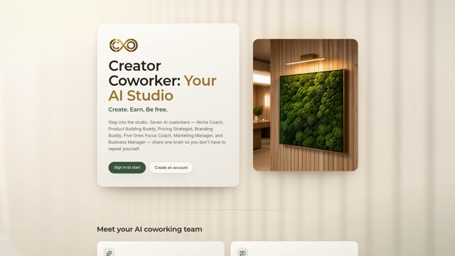
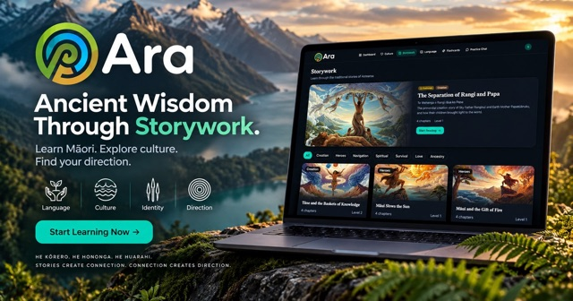
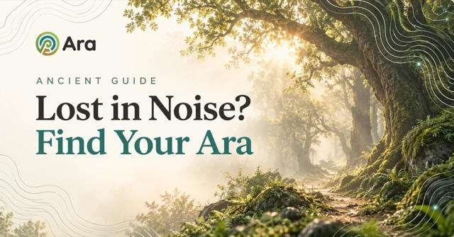
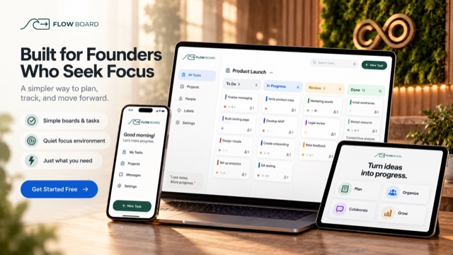
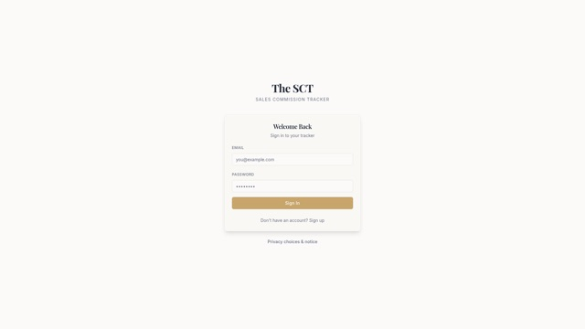
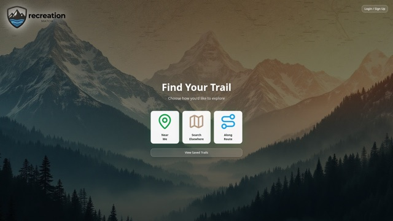
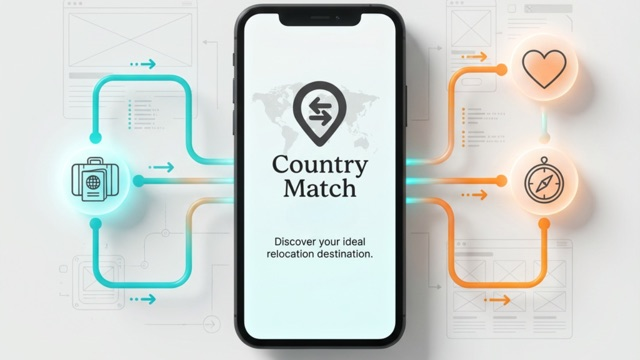

# Hi, I'm Shannon McGivney 👋

**Founder of [AI Workforce Training ](https://aiworkforce.training)** a DBA of McGivney Media LLC. I build AI training programs and AI-powered apps for workforce boards, Tribal programs, youth programs and the people they serve.

  

I'm not a traditional software engineer. I design the product, write the specs and build with AI tools (Lovable, Claude Code), then ship the result to real learners and partners. This page collects that work.

---

## 🏢 Businesses

| Brand | What it does | Link |
|---|---|---|
| **AI Workforce Training** | Home of the **AI Opportunity Accelerator (AIOA)**: self-paced AI and human-skills training, hands-on labs and stackable badges for workforce boards, Tribal programs and YouthBuild. | [aiworkforce.training](https://aiworkforce.training) |
| **Cre8ive Origins** | The learning platform behind AIOA, plus a family of tools that connect people with themselves, each other and nature. | [cre8iveorigins.life](https://cre8iveorigins.life) |
| **Wingman Agents** *(in development)* | AI study partners for CNA/nursing students and construction apprentices: ask the same question as many times as you need, no judgment. | Coming soon |

---

## 🛠️ Software I've built

### Learning & course creation

<table>
<tr>
<td width="260"></td>
<td><a href="https://creatorcoworkers.cre8iveorigins.life"><b>Course Creator Coworker</b></a> A team of AI coaches for niche, course structure, pricing, branding and launch copy.</td>
</tr>
<tr>
<td width="260"></td>
<td><a href="https://kiaora.life"><b>Ara Māori</b></a> Māori language lessons with vocabulary, grammar and flashcards.</td>
</tr>
<tr>
<td width="260"></td>
<td><a href="https://ara.guide"><b>Ara Cards: Daily Wisdom</b></a> Daily wisdom cards with a journey tracker, notes, audio lessons and an AI guide.</td>
</tr>
</table>

### Business productivity

<table>
<tr>
<td width="260"></td>
<td><a href="https://flowboard.cre8iveorigins.life"><b>Flow Board</b></a> Cadence-driven Kanban boards for tasks and sales pipelines, with AI-suggested next steps.</td>
</tr>
<tr>
<td width="260"></td>
<td><b>The SCT: Sales Commission Tracker</b> Logs sales, calculates commission and exports to CSV. Built mobile-first.</td>
</tr>
</table>

### Culture, wellbeing & place (Cre8ive Origins)

<table>
<tr>
<td width="260"></td>
<td><a href="https://lunarsync.cre8iveorigins.life"><b>LunarSync</b></a> Monthly guides based on the Maramataka (Māori lunar calendar), with calendar sync.</td>
</tr>
<tr>
<td width="260"></td>
<td><a href="https://astroly.me"><b>Astroly</b></a> Astrocartography heatmaps that map "Thrive Zones" around the world.</td>
</tr>
</table>

### Explorations

<table>
<tr>
<td width="260"></td>
<td><a href="https://recreationmatch.cre8iveorigins.life"><b>Recreation Match</b></a> Find trails near you or along a road trip, with drive times and AI review summaries.</td>
</tr>
<tr>
<td width="260"></td>
<td><a href="https://www.cre8iveorigins.life/en/course-detail/country-match-quiz/35477/"><b>Country Match</b></a> Matches you with three countries based on priorities, deal breakers and visa eligibility.</td>
</tr>
</table>

---

## 🎓 Free Claude skills

Made with Claude Code for my students and anyone building with AI. Most install in Claude.ai (upload the zip) or Claude Code; the ones marked Claude Code only need your own computer.

| Pack | What it does | Link |
|---|---|---|
| **LinkedIn Profile Glow-Up** | 10 Claude skills that walk you through a 9-step LinkedIn makeover (photo, banner, headline, About, Featured, posts), plus an audit that scores your profile out of 18. Works in Claude.ai and Claude Code. | [Repo](https://github.com/shannonmcgivney/linkedin-profile-glowup) · [Download](https://github.com/shannonmcgivney/linkedin-profile-glowup/releases/latest/download/LinkedIn-Glow-Up-Pack-UNZIP-FIRST.zip) |
| **Consent Before Tracking** | 3 Claude skills that stop a vibe-coded app from tracking visitors before they click Accept: a pre-publish check, an audit of every pixel and script, and the fix (a banner that actually waits). Works in Claude.ai and Claude Code. | [Repo](https://github.com/shannonmcgivney/consent-before-tracking) · [Download](https://github.com/shannonmcgivney/consent-before-tracking/releases/latest/download/Consent-Before-Tracking-Pack-UNZIP-FIRST.zip) |
| **Content Angles** | Writes posts, short-video scripts and emails from 7 reusable story angles (Mistake, Myth, Client, Reframe, Problem, Prescription, Origin), one at a time or a week at once. | [Repo](https://github.com/shannonmcgivney/content-angles) · [Download](https://github.com/shannonmcgivney/content-angles/releases/latest/download/content-angles.zip) |
| **Human** (`/human`) | Rewrites any draft so it reads like a person wrote it, with none of the common AI-writing tells, plus a linter that flags them. | [Repo](https://github.com/shannonmcgivney/human-writing) · [Download](https://github.com/shannonmcgivney/human-writing/releases/latest/download/human.zip) |
| **Draft Follow-Up Email** | Say "draft follow-up email" after a meeting and Claude reads your Wispr Flow transcript, then saves a Gmail draft with a thank-you, a two-sentence recap, next steps by owner and what you promised to send. It never sends, and it keeps personal details out. | [Repo](https://github.com/shannonmcgivney/draft-follow-up-email) · [Download](https://github.com/shannonmcgivney/draft-follow-up-email/releases/latest/download/draft-follow-up-email.zip) |
| **Ad Launch Preflight** | Five checks before you spend on Reddit, Meta, LinkedIn, Google or TikTok ads: one goal with a target number, tracking that's tested and waits for cookie consent, enough different ads to learn from, an audience that fits, and pause and scale rules written down before launch. Ends in a GO or FIX FIRST brief. | [Repo](https://github.com/shannonmcgivney/ad-launch-preflight) · [Download](https://github.com/shannonmcgivney/ad-launch-preflight/releases/latest/download/ad-launch-preflight.zip) |
| **Launch Week** | Get your app's first users for free. Plans a launch week on Peerlist, Microlaunch, Show HN and Product Hunt with a post written for each, and builds a free-tool page for your link in bio that keeps visitors' emails (with opt-in) after the launch spike ends. | [Repo](https://github.com/shannonmcgivney/launch-week) · [Download](https://github.com/shannonmcgivney/launch-week/releases/latest/download/Launch-Week-Pack-UNZIP-FIRST.zip) |
| **Self-Improving Claude** | Claude gets better the more you use it. Reads your saved Claude Code sessions and shows where Claude keeps going wrong, what you keep re-explaining and which jobs you do by hand, then builds the skills you're missing. Also includes a retro after each job and a "watch this reel and build what it teaches" workflow. Claude Code only. | [Repo](https://github.com/shannonmcgivney/self-improving-claude) · [Download](https://github.com/shannonmcgivney/self-improving-claude/releases/latest/download/Self-Improving-Claude-Pack.zip) |

---

## 🤖 How I build

- **Lovable** for full-stack apps (React, TypeScript, Supabase)
- **Claude Code** for automations, reusable AI skills and documentation
- **Claude Projects** as standing AI "teams," one per business goal
- A documented process: every step of building McGivney Media is logged, from idea to autonomous operation

---

## 📫 Connect

The best way to reach me is a message on **[LinkedIn](https://www.linkedin.com/in/shannonmcgivney/)**.

- 💼 [LinkedIn](https://www.linkedin.com/in/shannonmcgivney/)
- 🌐 [aiworkforce.training](https://aiworkforce.training)
- ▶️ [YouTube](https://www.youtube.com/@Shannon.McGivney)
